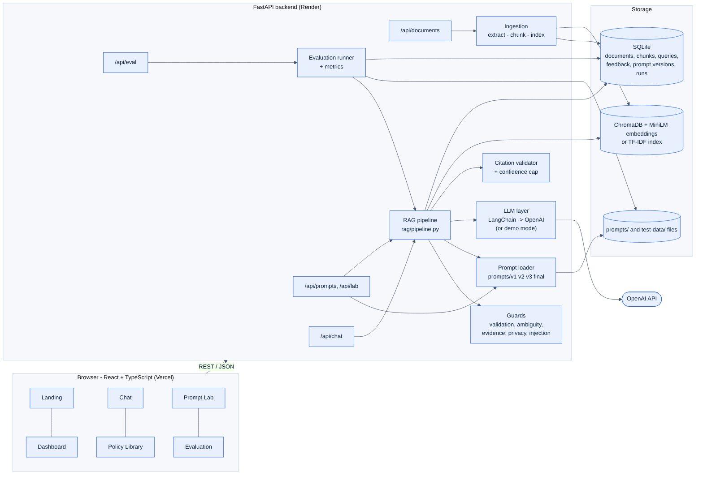

# CampusSage — AI-Powered University Policy & Student Helpdesk

CampusSage answers students' questions about **attendance, examinations, fees, hostel and academic rules** using
only official policy documents. Every answer quotes the exact clause, names the document and section, and carries an
evidence-based confidence level. When the documents don't cover a question, CampusSage says so and names the office
to contact. It also asks a clarifying question when a query is ambiguous, and flags it when two documents contradict
each other.

| | |
|---|---|
| Course | SCSE4041 Prompt Engineering · Bennett University |
| Team | **Agentic Minds** · Team ID **PE-B01-18** · Batch group B01 – B12 |
| Members | Snehil Jha (team leader), Tanya Sinha |
| Problem source | Problem Pool, **C1** |
| Live demo (public, no login) | https://snehiljha1017.github.io/campussage-policy-helpdesk/: the full app in demo mode (no model call) |
| Live demo with Claude | https://claude.ai/artifact/WTt2vSvfwz1VMsun82qr21 (claude.ai sign-in; the owner must share it) |
| Repository | https://github.com/Snehiljha1017/campussage-policy-helpdesk |
| Reel | `TODO: add Drive / unlisted YouTube link` |

> **About the bundled documents.** `sample-documents/` contains six clearly labelled **SAMPLE** policies, written so
> the system can be demonstrated and tested end to end. They are **not** official Bennett University policy. Upload
> real, public university PDFs from the Policy Library page to replace them.

---

## Milestone 2 deliverables (in this repository)

| What | Where |
|---|---|
| Milestone 2 PDF (7 sections) + editable Word version | `docs/milestone2/M2_PE-B01-18_CampusSage.pdf` / `.docx` |
| Supporting document (technical report, 1 page) | `docs/milestone2/AgenticMinds_TechnicalReport.pdf` / `.docx` |
| Screenshots of real runs, captioned with test numbers | `docs/screenshots/` |
| Diagrams (prompt workflow, task decomposition, input–output, architecture ×2, RAG pipeline) | `docs/architecture/`, `docs/workflow/` |
| Reel script (the 102-second reel itself is uploaded separately) | `docs/milestone2/Demo_Reel_Script.md` |
| Rebuild both documents from the repo data | `python scripts/build_m2_docs.py` (team details in `docs/milestone2/m2_inputs.json`) |

## What is in the box

| Page | What it does |
|---|---|
| **Landing** | Product overview, features, how it works, categories, trust & privacy |
| **Dashboard** | Ask box, stats, category shortcuts, recent questions, recent documents, FAQ |
| **Ask CampusSage** (chat) | Cited answers with status, verified quotation, document + section, confidence, office suggestion, copy and feedback buttons, a 10-step pipeline trace and the retrieved excerpts |
| **Policy Library** | Upload PDF → extract → clause chunking → embed → index; view extracted clauses; search; re-index; delete |
| **Prompt Lab** | Run one question through V1/V2/V3 side by side; prompt editor (save new versions); version history; lab run log; measured metrics chart per version |
| **Evaluation** | Run the 14-case suite (or 8-case holdout) on any configuration, live progress, Recharts charts, Normal/Edge/Invalid filter, results table, CSV and Markdown export |
| **About & Team** | Project, team, problem, solution, stack, future scope |

## Architecture



The RAG pipeline follows the ten-step workflow of the project brief: validate → retrieve → rank → **check evidence** → build
prompt → apply final system prompt → generate → **validate citations** → return or decline
([diagram](docs/architecture/rag_pipeline.png)).

Key design decisions:

* **Clause-aware chunking.** Chunks are split on numbered clauses (`2.1`, `3.2`), so every chunk carries its section number
  and citations can be verified mechanically.
* **Deterministic guards around the LLM.** Gibberish, a single ambiguous term ("What is the deadline?"), requests for
  another student's records and questions with no supporting clause are handled *before* any model call. Instruction-like
  text ("ignore previous instructions…") is flagged and removed.
* **Citation validation after the LLM.** Each quotation must be found (≥ 90 % similarity) in a retrieved clause, and every
  number in the answer must appear in the evidence. In the chat, an answer with no verifiable quotation is withheld
  rather than shown.
* **Confidence is capped by evidence.** The confidence shown is the lower of the model's claim and an evidence-based
  level (`backend/rag/confidence.py`).
* **Prompt versions live in files** (`prompts/v1..v3`, `prompts/final`). The backend reads those files directly, so the
  repository and the running app can't drift apart.

## Quick start (local)

Requirements: Python 3.10+ and Node 18+.

```bash
# 1. Backend
cd backend
python -m venv .venv && source .venv/bin/activate      # Windows: .venv\Scripts\activate
pip install -r requirements.txt                         # light: TF-IDF retrieval
#   or: pip install -r requirements-full.txt            # + ChromaDB & sentence-transformers (semantic search)
cp ../.env.example .env                                 # then put your OPENAI_API_KEY in backend/.env
uvicorn main:app --reload --port 8000                   # API docs: http://localhost:8000/docs

# 2. Frontend (new terminal)
cd frontend
npm install
cp .env.example .env                                    # VITE_API_URL=http://localhost:8000
npm run dev                                             # http://localhost:5173
```

On first start, the API loads and indexes the six sample PDFs automatically.

### Demo mode (no API key)

Without an `OPENAI_API_KEY` (or `ANTHROPIC_API_KEY`), the app runs in a clearly labelled **demo mode**. Retrieval, guards,
citation validation and the whole UI work, but answers are extracted word for word from the best clause instead of
being generated by a model. Every screen and API response says so. The Prompt Lab shows the exact prompts each version
would send, but cannot compare outputs without a model.

### LLM options

| Variable | Meaning |
|---|---|
| `OPENAI_API_KEY`, `OPENAI_MODEL` | Default provider (via LangChain `ChatOpenAI`). Model is configurable; default `gpt-4o-mini`. |
| `OPENAI_BASE_URL` | Any OpenAI-compatible endpoint (Azure, OpenRouter, Groq, local Ollama…) |
| `LLM_PROVIDER=anthropic` + `ANTHROPIC_API_KEY` | Use Claude instead (install `langchain-anthropic`) |
| `VECTOR_BACKEND` | `auto` (Chroma if installed), `chroma`, or `tfidf` |

## Tests and evaluation

```bash
cd backend
python -m pytest -q                                     # 8 unit tests (parser, citations, guards, decline logic)
python -m evaluation.runner                             # 14-case suite through the production pipeline
python -m evaluation.runner --configs system v1 v2 v3 --repeats 3   # prompt comparison (needs an API key)
python -m evaluation.runner --suite holdout             # 8 unseen questions
```

Each run writes `test-data/outputs/runNNN_*_outputs.csv`, `test-data/evaluation_results/runNNN_*.json` (with every raw
model output) and a ready-to-paste Markdown test table. The same runs can be started from the Evaluation page.

**Results so far, honestly stated** (`test-data/evaluation_results/`):

| Run | Mode | Suite | Result |
|---|---|---|---|
| 001 | demo (no LLM) | main, 14 tests | 14 / 14 passed |
| 002 | demo (no LLM) | holdout, 8 tests | 7 / 8 passed: H05 Hinglish *"hostel mein raat ko kitne baje tak aana hai?"* wrongly declined |

Overall: **21 / 22 test inputs passed** (the Milestone 2 test table lists all 22).

The guard thresholds were tuned while looking at the main suite, so 14/14 overstates how well the system generalises.
The holdout suite was written afterwards and never used for tuning, which makes it the fairer estimate. **The V1 vs V2
vs V3 prompt comparison has not been run yet**: it needs an API key. Run the second command above and use its
output in the Milestone 2 iteration log.

## Hosted prototype (no server)

`frontend/hosted/` builds the same React app with the backend ported to TypeScript and running in the browser,
published as a claude.ai page. It uses Claude (with the viewer's consent) as the model, or the labelled demo mode, and the
same prompts, sample clauses, guards, citation checks and test suites. A parity check found it identical to the Python backend on all 22
test inputs. See `frontend/hosted/README.md`. Build: `npm run build:hosted`.

## Deployment

* **Backend → Render.** `render.yaml` is a ready blueprint (light requirements, TF-IDF retrieval, fits the free tier).
  Set `OPENAI_API_KEY` and `CORS_ORIGINS` in the dashboard, never in the file. The free tier's disk is temporary:
  uploaded PDFs and the SQLite database reset on redeploy, and the sample PDFs are re-indexed automatically.
* **Frontend → Vercel.** Root directory `frontend`, framework Vite, env `VITE_API_URL=https://<your-render-app>.onrender.com`.
  `vercel.json` rewrites all routes to `index.html`.
* Test both links in a private/incognito window before submitting.

## Repository layout

```
CampusSage/
├── frontend/                 React + TypeScript + Tailwind + Framer Motion + Recharts + Lucide (code)
│   └── src/{pages,components,services,assets}
├── backend/                  FastAPI (code)
│   ├── main.py               app, CORS, startup indexing, /api/health, /api/stats
│   ├── api/                  routes: chat, documents, prompt lab, evaluation
│   ├── rag/                  pipeline, retrieval, rerank, guards, LLM layer, parser, citations, confidence
│   ├── prompts/loader.py     reads ../prompts/*
│   ├── document_processing/  PDF extraction, clause chunking, ingestion
│   ├── evaluation/           metrics + test runner (CLI and background)
│   ├── database/             SQLite schema and helpers
│   └── tests/                unit tests
├── prompts/{v1,v2,v3,final}/ one file per prompt version (with reasons for each change)
├── test-data/inputs/         test_cases.json (14), holdout_cases.json (8)
├── test-data/outputs/        CSV of every run
├── test-data/evaluation_results/  JSON (incl. raw outputs) + Markdown tables
├── docs/architecture, docs/workflow   diagrams (.mmd source + .png/.svg)
├── docs/milestone2/          Milestone 2 PDF content, technical report, reel script, checklist, form answers
├── docs/screenshots/         add real screenshots here
├── sample-documents/         labelled SAMPLE policy PDFs (+ scripts/generate_sample_policies.py)
├── app/ + index.html         built hosted app served by GitHub Pages (rebuild: cd frontend && npm run build:pages)
├── docs/policy_sources.md    real Bennett policy sources used by the earlier prototype
├── .env.example  render.yaml  CHANGELOG.md
```

The course guideline asks for a `code/` folder; in this repository the code lives in `frontend/` and `backend/`.

## Earlier prototype

Until 22 Nov 2026 this repository held an earlier, model-free "policy workbench" (prompt files in `.txt`, a GitHub Pages
page and 12 local checks, based on a paraphrase of the Bennett Examination Manual 2024-25). It was replaced by the full
application; it is preserved in the git history at commit `04ea202`
(`git checkout 04ea202` to view it). Its source notes are kept in `docs/policy_sources.md`.

## Security

API keys are read from environment variables only. `.env` files are git-ignored. No student records are used or stored;
the only personal data CampusSage keeps is the questions typed into it (stored in the local SQLite database for history
and evaluation).
